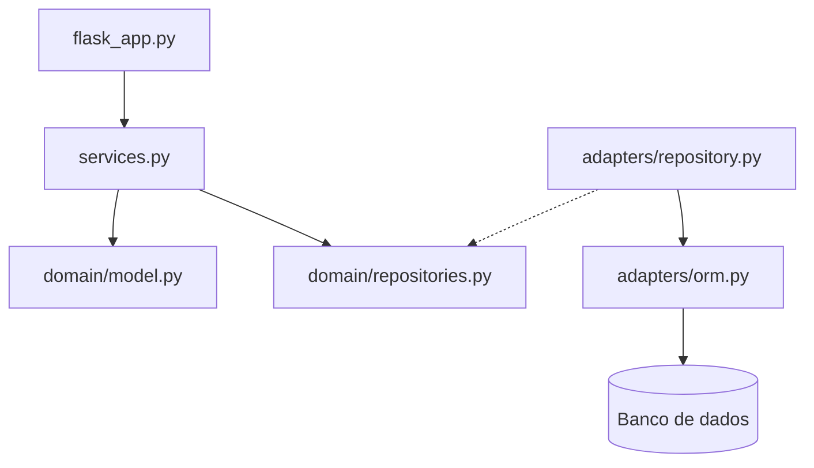

# Arquitetura do Sistema de Operações de Companhia Aérea

## 1. Escopo

## 2. Requisitos arquiteturais

### 2.1 Atributos de qualidade e cenários

Em ordem de prioridade, com os nomes da ISO/IEC 25010: **corretude das regras de negócio** (adequação funcional), **modificabilidade** e **testabilidade** (as duas de manutenibilidade).

Ficaram de fora os atributos que hoje não influenciam a estrutura do sistema. Desempenho e disponibilidade não têm nenhuma meta definida, como número de acessos ou horário de funcionamento. Segurança também não entrou, porque nenhum requisito pede login ou controle de acesso. Usabilidade, que a norma chama de capacidade de interação, não se aplica, porque o sistema não tem telas, só a API.

#### Cenário 1 - Corretude das regras de negócio

Um erro aqui atrapalha a operação da companhia: vender um assento que não existe, agendar voo com avião em manutenção, escalar tripulante acima do teto de horas ou despachar bagagem acima da carga máxima.

- **Fonte:** um operador usando a API.
- **Estímulo:** pede para alocar um assento num voo (`POST /voos/<numero>/assentos`).
- **Ambiente:** operação normal, com um pedido de cada vez, num voo agendado com um único assento livre.
- **Artefato:** agregado Voo, no método `Voo.alocar_assento()`, chamado por `VooService.alocar_assento()`.
- **Resposta:** o sistema aloca o último assento e recusa os pedidos seguintes com erro 400 e uma mensagem.
- **Medida da resposta:** zero assentos alocados além da capacidade.

Como verificar: `test_erro_alocar_voolotado`, em `tests/unit/domain/test_voo.py`, e `test_alocar_assento_ate_lotar_pela_api`, em `tests/e2e/test_api_voo.py`.

#### Cenário 2 - Modificabilidade

O sistema já mudou bastante durante o desenvolvimento: começou com quatro agregados, passou para sete, e a regra de lotação saiu da Reserva e foi para o Voo. Uma mudança numa parte não deve obrigar a mexer nas outras.

- **Fonte:** a equipe de desenvolvimento.
- **Estímulo:** quer agendar voos por outra entrada além da API, como uma linha de comando ou a importação de um arquivo.
- **Ambiente:** desenvolvimento, com o sistema já em uso pela API.
- **Artefato:** casos de uso do Voo, no `VooService`.
- **Resposta:** basta escrever o código da nova entrada, que chama `VooService.agendar_voo`, sem reescrever nenhuma regra.
- **Medida da resposta:** zero arquivos alterados em `src/airline/domain/` e `src/airline/service_layer/`, apenas arquivos novos em `src/airline/entrypoints/`.

Como verificar: os testes de `tests/unit/service_layer/test_voo_service.py` já chamam o `VooService` sem passar pelo Flask, como se fossem uma segunda entrada.

#### Cenário 3 - Testabilidade

Quem altera uma regra precisa saber na hora se quebrou alguma coisa, e isso só funciona se os testes forem rápidos e não dependerem de banco.

- **Fonte:** um desenvolvedor.
- **Estímulo:** altera uma regra de domínio ou um caso de uso.
- **Ambiente:** máquina local, sem banco de dados e sem servidor.
- **Artefato:** camadas `domain/` e `service_layer/`.
- **Resposta:** os testes unitários conferem a mudança usando repositórios falsos (`FakeVooRepository`) e uma sessão falsa (`FakeSession`) no lugar do banco.
- **Medida da resposta:** todos os testes unitários rodam em menos de 1 segundo. Hoje são 81 testes em 0,06 s (`pytest tests/unit`).

### 2.2 Restrições

Como é um trabalho de disciplina, várias restrições vêm do próprio curso:

- A stack é obrigatória: Python 3, pytest, SQLAlchemy e Flask ou FastAPI. O grupo escolheu Flask, com um banco SQLite num único arquivo.
- As pastas do código (`domain/`, `service_layer/`, `adapters/` e `entrypoints/`) seguem o modelo do Apêndice B do livro-texto.
- São cinco pessoas trabalhando ao mesmo tempo no mesmo repositório, cada uma responsável por um ou dois agregados.

### 2.3 Objetivos da arquitetura

- Manter cada regra de negócio dentro do agregado a que ela pertence.
- Permitir que cada integrante trabalhe no próprio agregado em paralelo.
- Testar as regras sem banco nem servidor.
- Manter o domínio livre de Flask e SQLAlchemy.

## 3. Arquitetura atual

O sistema aéreo adota uma arquitetura organizada em camadas, combinando conceitos de *Ports & Adapters*
(Arquitetura Hexagonal) com os padrões Repository e Service Layer.
Essa organização busca separar as regras de negócio dos detalhes de infraestrutura,
como persistência de dados e comunicação HTTP.

### Camadas e componentes

**1. Camada de entrada — Entrypoints**

Localizada em `src/airline/entrypoints/`, contém o arquivo `flask_app.py`, responsável por expor os endpoints HTTP da
aplicação. Essa camada recebe as requisições, instancia os serviços e seus repositórios, converte os resultados em
respostas JSON e traduz exceções em códigos HTTP.

**2. Camada de serviços — Service Layer**

Localizada em `src/airline/service_layer/`, contém `services.py`, que coordena os casos de uso da aplicação.
Serviços como `ReservaService`, `PassageiroService` e `VooService` organizam as operações, consultam repositórios e
acionam as regras de negócio do domínio. Essa camada evita concentrar toda a lógica de aplicação nos endpoints.

**3. Camada de domínio — Domain**

Localizada em `src/airline/domain/`, contém `model.py`, `repositories.py` e os módulos de exceções de domínio.
O arquivo `model.py` reúne as entidades, os objetos de valor, os estados e as regras de negócio. Já `repositories.py`
define os contratos que os repositórios devem implementar.

O domínio não precisa conhecer o Flask nem os detalhes de persistência do SQLAlchemy. 
Dessa forma, suas regras podem ser testadas independentemente da infraestrutura.

**4. Camada de adaptadores — Adapters**

Localizada em `src/airline/adapters/`, contém `repository.py` e `orm.py`. O primeiro implementa os contratos de
repositório utilizando SQLAlchemy; o segundo define os modelos ORM utilizados para persistir os dados.
Os repositórios fazem a conversão entre os objetos de domínio e os modelos de persistência.

### Padrões arquiteturais adotados

- **Arquitetura em camadas:** separa entrada HTTP, coordenação dos casos de uso, regras de negócio e infraestrutura.
- **Ports & Adapters:** os contratos de repositório representam portas de acesso à persistência, enquanto os repositórios SQLAlchemy funcionam como adaptadores concretos.
- **Repository:** encapsula as operações de consulta e gravação, evitando que os serviços precisem manipular diretamente as consultas SQLAlchemy.
- **Service Layer:** centraliza a coordenação dos casos de uso, incluindo verificações de existência e a interação entre diferentes repositórios.

### Direção das dependências

- Os serviços dependem do domínio e dos contratos de repositório.
- Os adaptadores de persistência dependem dos modelos de domínio e implementam esses contratos.
- A camada de entrada utiliza os serviços e instancia os adaptadores concretos para conectar os componentes.

### Diagrama de componentes

### Mapeamento para as pastas de `src/`

| Componente | Localização | Responsabilidade |
| :--- | :--- | :--- |
| **Entrypoints** | `src/airline/entrypoints/` | Endpoints HTTP e respostas da API |
| **Service Layer** | `src/airline/service_layer/` | Coordenação dos casos de uso |
| **Modelos de domínio** | `src/airline/domain/model.py` | Entidades e regras de negócio |
| **Contratos de repositório** | `src/airline/domain/repositories.py` | Interfaces de persistência |
| **Exceções de domínio** | `src/airline/domain/exception.py` | Erros relacionados às regras e operações do domínio |
| **Adaptadores de repositório** | `src/airline/adapters/repository.py` | Consultas e gravações via SQLAlchemy |
| **Modelos ORM** | `src/airline/adapters/orm.py` | Mapeamento entre objetos Python e tabelas |

## 4. Análise de trade-offs

### 4.1 Impacto nos atributos de qualidade

**Corretude das regras de negócio**

A arquitetura favorece a corretude ao concentrar as regras nos agregados. A Aeronave calcula sua disponibilidade considerando a validade da vistoria e as ordens de manutenção pendentes. O Voo controla a alocação de assentos e impede que sua capacidade seja ultrapassada. Como essas regras ficam no domínio, diferentes entradas podem utilizá-las sem duplicar sua implementação.

Entretanto, essa proteção tem limites quando uma regra depende de agregados diferentes. A disponibilidade da aeronave é verificada ao agendar o voo, mas não é consultada novamente ao realizá-lo. Assim, uma aeronave que entre em manutenção depois do agendamento não impede automaticamente a realização dos voos associados.

**Modificabilidade**

A separação entre entrada HTTP, serviços, domínio e persistência permite alterar uma parte sem necessariamente modificar as demais. Por exemplo, uma entrada por linha de comando pode chamar os serviços existentes sem alterar as regras de negócio, atendendo ao cenário da seção 2.

Por outro lado, algumas mudanças exigem ajustes em várias camadas. Adicionar um atributo persistido pode envolver o modelo de domínio, o modelo ORM e a conversão feita pelo repositório. Além disso, vários agregados compartilham arquivos como `model.py`, `services.py` e `flask_app.py`, aumentando a possibilidade de conflitos durante o trabalho paralelo.

**Testabilidade**

Os contratos de repositório permitem substituir o acesso ao banco por implementações falsas nos testes dos serviços. O domínio também pode ser testado sem Flask ou SQLAlchemy. No agregado Aeronave, receber a data como parâmetro em `esta_disponivel(hoje)` permite testar a validade da vistoria sem depender da data de execução.

A limitação é que os repositórios falsos não reproduzem todas as restrições da persistência real. Portanto, os testes unitários precisam ser complementados por testes de integração e de API.

### 4.2 Trade-offs identificados

**Testabilidade × simplicidade**

Separar domínio, contratos, modelos ORM e repositórios facilita testar regras e serviços sem banco. Em contrapartida, aumenta a quantidade de componentes e exige manter conversões entre objetos de domínio e objetos de persistência.

Na versão analisada, `orm.py` possui 219 linhas e `repository.py` possui 248, totalizando 467 linhas, enquanto `model.py` possui 290. A contagem não mede a qualidade da arquitetura, mas evidencia o código necessário para sustentar essa separação. O ganho de isolamento nos testes vem acompanhado de maior esforço de implementação e manutenção.

**Corretude × desempenho**

Conforme o ADR 0004, as ordens de manutenção pertencem ao agregado Aeronave, e sua disponibilidade é calculada a partir da vistoria e das ordens pendentes. Isso mantém a regra concentrada no agregado e evita armazenar um indicador de disponibilidade que possa ficar desatualizado.

Entretanto, toda busca de uma aeronave reconstrói também suas ordens de manutenção, inclusive as antigas e concluídas. Uma consulta de disponibilidade carrega, portanto, mais informações do que precisa. Conforme o histórico crescer, esse carregamento pode prejudicar o desempenho. Trata-se de um custo potencial, pois ainda não há uma medição que demonstre lentidão.

**Modificabilidade × consistência entre agregados**

Conforme o ADR 0003, o Voo referencia a Aeronave pelo prefixo e copia sua capacidade no agendamento. Isso permite que os dois agregados evoluam separadamente e evita consultar a aeronave a cada alocação de assento.

O custo dessa independência é que alterações posteriores na aeronave não são refletidas automaticamente nos voos. Se ela entrar em manutenção, os voos já agendados continuam podendo ser realizados. Preservar a consistência exige uma coordenação adicional, como verificar novamente a disponibilidade antes da realização do voo.

### 4.3 Risco identificado

Um risco concreto é a diferença de comportamento entre o repositório falso e o repositório SQLAlchemy da Aeronave.

O `FakeAeronaveRepository.salvar()` substitui o objeto armazenado em memória, permitindo atualizar uma aeronave existente. Já o `SqlAlchemyAeronaveRepository.salvar()` sempre cria um novo registro. Ao salvar novamente uma aeronave depois de abrir ou concluir uma ordem de manutenção, ocorre conflito de chave primária. Essa limitação está registrada no ADR 0004, que também informa que as rotas de manutenção não foram expostas na API.

Com isso, os testes unitários de manutenção podem passar mesmo que o caso de uso falhe com o banco real. Para reduzir esse risco, é necessário implementar a atualização no repositório e incluir testes de integração que cadastrem uma aeronave, abram e concluam uma ordem e confirmem o estado por uma nova consulta ao banco.

## 5. Alternativa

Uma alternativa seria uma aplicação Flask com modelos SQLAlchemy organizados no estilo Active Record. Nessa organização, o mesmo objeto reuniria os dados persistidos, as regras de negócio e os métodos de consulta e gravação. As rotas chamariam esses modelos diretamente, sem contratos de repositório nem uma camada de serviços separada.

Por exemplo, a classe Aeronave seria também o modelo da tabela `aeronaves`, mantendo o relacionamento com as ordens de manutenção. Seus métodos verificariam a disponibilidade e permitiriam abrir ou concluir ordens. A rota buscaria a aeronave, chamaria o método correspondente e confirmaria a transação. No agendamento de um voo, a própria rota coordenaria a consulta da aeronave e a criação do voo.

### 5.1 Comparação pelos atributos priorizados

A tabela resume a comparação. Os parágrafos seguintes detalham cada atributo.

| Atributo | Arquitetura atual (camadas + Repository) | Active Record |
| :--- | :--- | :--- |
| **Corretude** | (+) Regras concentradas nos agregados e independentes da persistência. (−) Regras entre agregados exigem coordenação adicional. | (+) Regras podem ser protegidas nos modelos ORM. (−) Ficam junto da persistência, e a coordenação nas rotas pode ser duplicada entre entradas. |
| **Modificabilidade** | (+) Serviços podem ser reutilizados por novas entradas. (−) Algumas mudanças exigem ajustes no domínio, no ORM e no repositório. | (+) Alterações simples envolvem menos componentes. (−) Mudanças na persistência afetam os modelos que contêm as regras. |
| **Testabilidade** | (+) Domínio e serviços testados sem banco, com repositórios falsos. (−) A persistência exige testes de integração separados. | (+) Regras que operam só sobre atributos podem ser testadas sem banco. (−) Métodos que consultam ou gravam dados exigem infraestrutura de teste. |

**Corretude das regras de negócio**

Na arquitetura atual, as regras ficam nos agregados, separadas dos detalhes de persistência. Isso facilita identificar e testar as condições que precisam ser preservadas.

Na alternativa, as regras também poderiam ser centralizadas nos métodos dos modelos. Portanto, Active Record não impediria a proteção das regras. A diferença seria sua proximidade com o código de persistência e a concentração da coordenação entre modelos nas rotas. Sem cuidado, novas entradas poderiam duplicar essa coordenação ou deixar de executar alguma verificação.

A alternativa também eliminaria a conversão manual entre objetos de domínio e objetos ORM, reduzindo uma fonte de erros. Entretanto, isso não resolveria automaticamente problemas como verificar novamente a disponibilidade da aeronave antes de realizar um voo.

**Modificabilidade**

A arquitetura atual permite reutilizar os serviços em novas entradas sem alterar o domínio. Também concentra o acesso ao banco nos adaptadores.

Na alternativa, alterações simples poderiam exigir menos arquivos, pois não haveria duas representações de cada entidade nem repositórios intermediários. Porém, as regras dependeriam dos modelos SQLAlchemy, e a coordenação implementada nas rotas precisaria ser extraída ou repetida para atender uma nova entrada. Mudanças na tecnologia de persistência também afetariam diretamente os modelos que contêm as regras.

**Testabilidade**

A arquitetura atual permite testar domínio e serviços com repositórios falsos, sem banco nem servidor. Os adaptadores são verificados separadamente nos testes de integração.

Na alternativa, regras que operam somente sobre atributos ainda poderiam ter testes sem banco. Entretanto, testes de métodos que consultam ou gravam dados dependeriam de uma sessão e de um banco de teste. A combinação de regras e persistência reduziria o isolamento disponível na arquitetura atual, embora eliminasse a necessidade de testar a conversão entre dois modelos.

### 5.2 Escolha do grupo

Para o tamanho atual do sistema, a alternativa com Active Record reduziria a quantidade de código e simplificaria operações básicas de cadastro e consulta.

Mesmo assim, escolheríamos manter a arquitetura atual. A prioridade do projeto é preservar as regras de negócio, permitir modificações com impacto controlado e testar domínio e serviços sem infraestrutura. A separação adotada atende melhor a esses objetivos e também à organização exigida pela disciplina.

Essa escolha exige corrigir as limitações existentes, especialmente a atualização da Aeronave no repositório e a coordenação da disponibilidade com os voos. A separação em camadas oferece condições para tratar esses problemas, mas não garante sua solução automaticamente.

## 6. Evidências

- **Um caso de uso novo atravessa as camadas, mas não mexe na persistência.** O alocar assento alterou seis arquivos em quatro commits, com 74 linhas acrescentadas: model.py e test_voo.py no domínio, services.py e test_voo_service.py no serviço, test_api_voo.py no teste ponta a ponta e flask_app.py na rota. Nenhum arquivo de adapters/ mudou, porque o repositório do Voo já gravava todo o estado do voo, inclusive os assentos disponíveis. Fonte: git show --stat 78c3ae0 3bbb673 9654350 f5a33e8.

- **O tratamento de cadastro duplicado foi adicionado sem alterar a persistência.** O commit `94d4a24` modificou quatro arquivos: `domain/exception.py`, `service_layer/services.py`, `entrypoints/flask_app.py` e `tests/e2e/test_api_aeronave.py`. O serviço passou a verificar se o prefixo já estava cadastrado, e a rota passou a responder com erro 400. O teste acrescentado verifica que o primeiro cadastro retorna 201 e a repetição retorna 400. Nenhum arquivo de `adapters/` foi alterado, pois o contrato de repositório já oferecia a busca necessária. Isso evidencia a modificabilidade: foi possível alterar o comportamento utilizando a infraestrutura existente. Porém, não comprova diretamente o cenário de nova entrada da seção 2, pois a mudança ocorreu na API existente. Fonte: `git show --stat 94d4a24` e `git show 94d4a24`.

- **A separação entre domínio e persistência tem um custo de implementação observável.** Na versão `8c92b36`, o arquivo `adapters/orm.py` possui 219 linhas e `adapters/repository.py` possui 248, totalizando 467 linhas, enquanto `domain/model.py` possui 290. Os adaptadores mantêm os modelos de persistência e as conversões necessárias para que o domínio permaneça independente do SQLAlchemy. Essa contagem apoia o trade-off entre testabilidade e simplicidade discutido na seção 4: o isolamento exige código adicional de infraestrutura. A quantidade de linhas, que inclui comentários e linhas em branco, indica volume de código, mas não mede sozinha sua complexidade ou qualidade. Fonte: `wc -l src/airline/adapters/orm.py src/airline/adapters/repository.py src/airline/domain/model.py`.
