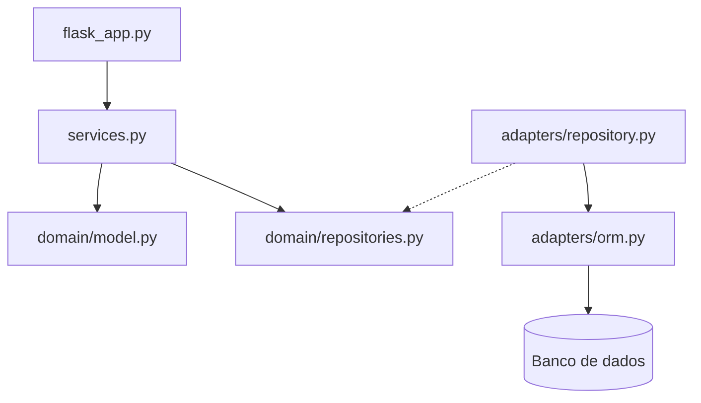

# Arquitetura do Sistema de Operações de Companhia Aérea

## 1. Escopo

## 2. Requisitos arquiteturais
### 2.1 Atributos de qualidade e cenários

Em ordem de prioridade, com os nomes da ISO/IEC 25010: **corretude das regras de negócio** (adequação funcional),  
**modificabilidade** e **testabilidade** (as duas de manutenibilidade).

Ficaram de fora os atributos que hoje não influenciam a estrutura do sistema. Desempenho e disponibilidade não têm nenhuma meta definida, como número de acessos ou horário de funcionamento. Segurança também não entrou, porque nenhum requisito pede login ou controle de acesso. Usabilidade, que a norma chama de capacidade de interação, não se aplica, porque o sistema não tem telas, só a API.

#### Cenário 1 - Corretude das regras de negócio

Um erro aqui atrapalha a operação da companhia: vender um assento que não existe, agendar voo com avião em manutenção, escalar tripulante acima do teto de horas ou despachar bagagem acima da carga máxima.

- **Fonte:** um operador usando a API.
- **Estímulo:** pede para alocar um assento num voo (`POST /voos/<numero>/assentos`).
- **Ambiente:** operação normal, com um pedido de cada vez, num voo agendado com um único assento livre.
- **Artefato:** agregado Voo, no método `Voo.alocar_assento()`, chamado por `VooService.alocar_assento()`.
- **Resposta:** o sistema aloca o último assento e recusa os pedidos seguintes com erro 400 e uma mensagem.
- **Medida da resposta:** zero assentos alocados além da capacidade.

Como verificar: `test_erro_alocar_voolotado`, em `tests/unit/domain/test_voo.py`, e `test_alocar_assento_ate_lotar_pela_api`, em `tests/e2e/test_api_voo.py`.

## 3. Arquitetura atual

O sistema aéreo adota uma arquitetura organizada em camadas, combinando conceitos de *Ports & Adapters*
(Arquitetura Hexagonal) com os padrões Repository e Service Layer.
Essa organização busca separar as regras de negócio dos detalhes de infraestrutura,
como persistência de dados e comunicação HTTP.

### Camadas e componentes

**1. Camada de entrada — Entrypoints**

Localizada em `src/airline/entrypoints/`, contém o arquivo `flask_app.py`, responsável por expor os endpoints HTTP da
aplicação. Essa camada recebe as requisições, instancia os serviços e seus repositórios, converte os resultados em
respostas JSON e traduz exceções em códigos HTTP.

**2. Camada de serviços — Service Layer**

Localizada em `src/airline/service_layer/`, contém `services.py`, que coordena os casos de uso da aplicação.
Serviços como `ReservaService`, `PassageiroService` e `VooService` organizam as operações, consultam repositórios e
acionam as regras de negócio do domínio. Essa camada evita concentrar toda a lógica de aplicação nos endpoints.

**3. Camada de domínio — Domain**

Localizada em `src/airline/domain/`, contém `model.py`, `repositories.py` e os módulos de exceções de domínio.
O arquivo `model.py` reúne as entidades, os objetos de valor, os estados e as regras de negócio. Já `repositories.py`
define os contratos que os repositórios devem implementar.

O domínio não precisa conhecer o Flask nem os detalhes de persistência do SQLAlchemy. 
Dessa forma, suas regras podem ser testadas independentemente da infraestrutura.

**4. Camada de adaptadores — Adapters**

Localizada em `src/airline/adapters/`, contém `repository.py` e `orm.py`. O primeiro implementa os contratos de
repositório utilizando SQLAlchemy; o segundo define os modelos ORM utilizados para persistir os dados.
Os repositórios fazem a conversão entre os objetos de domínio e os modelos de persistência.

### Padrões arquiteturais adotados

- **Arquitetura em camadas:** separa entrada HTTP, coordenação dos casos de uso, regras de negócio e infraestrutura.
- **Ports & Adapters:** os contratos de repositório representam portas de acesso à persistência, enquanto os repositórios SQLAlchemy funcionam como adaptadores concretos.
- **Repository:** encapsula as operações de consulta e gravação, evitando que os serviços precisem manipular diretamente as consultas SQLAlchemy.
- **Service Layer:** centraliza a coordenação dos casos de uso, incluindo verificações de existência e a interação entre diferentes repositórios.

### Direção das dependências

- Os serviços dependem do domínio e dos contratos de repositório.
- Os adaptadores de persistência dependem dos modelos de domínio e implementam esses contratos.
- A camada de entrada utiliza os serviços e instancia os adaptadores concretos para conectar os componentes.

### Diagrama de componentes

### Mapeamento para as pastas de `src/`

| Componente | Localização | Responsabilidade |
| :--- | :--- | :--- |
| **Entrypoints** | `src/airline/entrypoints/` | Endpoints HTTP e respostas da API |
| **Service Layer** | `src/airline/service_layer/` | Coordenação dos casos de uso |
| **Modelos de domínio** | `src/airline/domain/model.py` | Entidades e regras de negócio |
| **Contratos de repositório** | `src/airline/domain/repositories.py` | Interfaces de persistência |
| **Exceções de domínio** | `src/airline/domain/exception.py` | Erros relacionados às regras e operações do domínio |
| **Adaptadores de repositório** | `src/airline/adapters/repository.py` | Consultas e gravações via SQLAlchemy |
| **Modelos ORM** | `src/airline/adapters/orm.py` | Mapeamento entre objetos Python e tabelas |

## 4. Análise de trade-offs

## 5. Alternativa

## 6. Evidências
