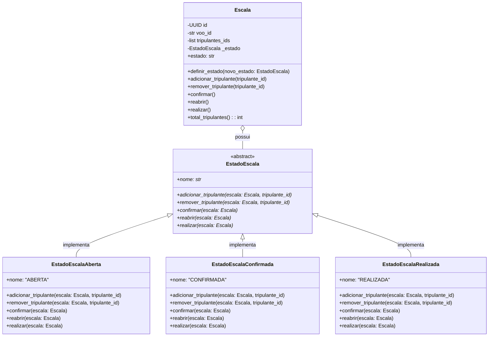
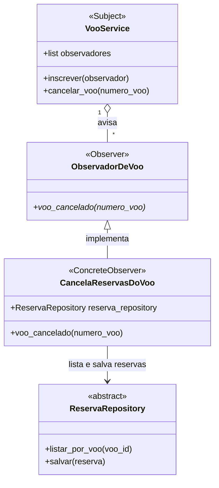
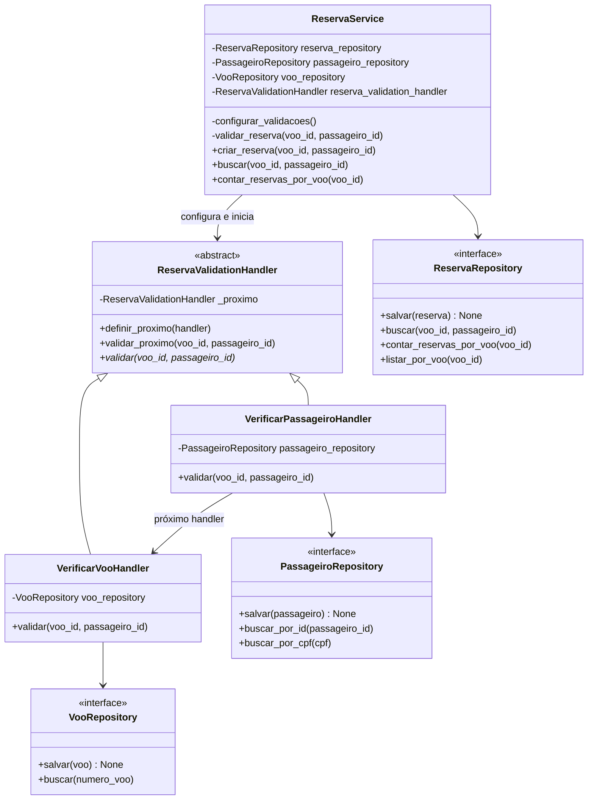

# Padrões de Projeto GoF

## Tripulante e Escala, Filipe Moreira

### Padrão: State (Comportamental)

### 1. Contexto no sistema e problema que ele resolve

No domínio de aviação comercial, uma escala de tripulação não é uma lista estática. Ela possui um ciclo de vida rigoroso regulado por normas operacionais:
1. **Planejamento/Aberta:** O despachante ou escalador aloca pilotos, copilotos e comissários. A tripulação pode ser ajustada, adicionada ou removida livremente.
2. **Confirmada/Homologada:** Antes da decolagem, a tripulação precisa ser confirmada e validada. Nesse estado, não é permitido adicionar ou remover tripulantes sem reabrir formalmente a escala.
3. **Realizada:** Após o voo concluído, a escala torna-se um registro histórico imutável para efeitos de auditoria da ANAC e contabilidade de horas voadas, não admitindo qualquer alteração ou reversão.

Na versão da Fase 1, a classe `Escala` permitia que tripulantes fossem adicionados ou removidos livremente a qualquer momento através de `adicionar_tripulante` e `remover_tripulante`. Não havia controle sobre o momento em que a escala estava pronta, nem proteção contra modificações indevidas em voos já realizados.

### 2. Por que esse padrão e alternativas consideradas

- **Por que State:** O padrão State permite que o objeto `Escala` altere seu comportamento quando seu estado interno muda, parecendo ter mudado de classe. O controle de transições e as regras de permissão/bloqueio ficam encapsulados em classes de estado dedicadas (`EstadoEscalaAberta`, `EstadoEscalaConfirmada`, `EstadoEscalaRealizada`), eliminando comandos condicionais complexos e permitindo novos estados (como `CANCELADA` ou `EM_SOBREAVISO`) sem violar o princípio Aberto/Fechado.
- **Alternativa considerada:** Usar um atributo enumerado `StatusEscala` e encher os métodos da `Escala` com verificações `if/elif` (ex.: `if self.status != StatusEscala.ABERTA: raise ...`). Essa abordagem foi descartada porque espalharia regras condicionais por múltiplos métodos, aumentaria a complexidade ciclomática da raiz e tornaria a adição de novos estados e transições propensa a erros e difícil de manter.

### 3. Participantes do padrão mapeados para classes reais

- **Context (`Contexto`):** `Escala` (`src/airline/domain/model.py`). Mantém uma referência para a instância do estado atual (`_estado`) e expõe métodos de negócio (`adicionar_tripulante`, `remover_tripulante`, `confirmar`, `reabrir`, `realizar`) delegando para o estado corrente.
- **State (`Estado Abstrato`):** `EstadoEscala` (`src/airline/domain/model.py`). Interface abstrata baseada em `ABC` que define as operações que variam conforme o estado da escala.
- **ConcreteStates (`Estados Concretos`):**
  - `EstadoEscalaAberta`: Permite alocar e remover tripulantes. Transita para `EstadoEscalaConfirmada` através de `confirmar()` (exige ao menos 1 tripulante).
  - `EstadoEscalaConfirmada`: Bloqueia inclusão e remoção de tripulantes (`ErroRegraTripulacao`). Permite `reabrir()` voltando para Aberta, ou `realizar()` transitando para Realizada.
  - `EstadoEscalaRealizada`: Bloqueia qualquer mutação na lista de tripulantes e rejeita qualquer nova transição de estado, garantindo a imutabilidade do registro operacional.

### 4. Diagrama de classes

### 5. Testes

Os testes que exercitam o padrão State e suas transições estão em:
- `tests/unit/domain/test_escala.py`:
  - `test_escala_inicia_no_estado_aberta`
  - `test_nao_deve_confirmar_escala_sem_tripulantes`
  - `test_escala_confirmada_bloqueia_adicao_e_remocao_de_tripulantes`
  - `test_escala_confirmada_pode_ser_reaberta_para_edicao`
  - `test_escala_realizada_bloqueia_qualquer_alteracao_e_imutabilidade`
  - `test_escala_aberta_nao_pode_ser_realizada_diretamente`
- `tests/unit/service_layer/test_tripulacao_service.py`:
  - `test_servico_nao_deve_escalar_tripulante_em_escala_confirmada`

Todos os testes foram integrados à suíte completa e executam com sucesso (163/163 testes verdes).

### 6. Custo da aplicação do padrão

A aplicação do padrão State introduz quatro classes adicionais (`EstadoEscala`, `EstadoEscalaAberta`, `EstadoEscalaConfirmada`, `EstadoEscalaRealizada`) e um nível de indireção, já que a entidade delega as ações para a instância polimórfica de estado. Além disso, a reconstrução a partir do banco de dados (`restaurar`) precisa mapear o estado persistido para a classe concreta correspondente através de um dicionário (`MAPA_ESTADOS_ESCALA`).

Esse custo é amplamente compensado pela clareza arquitetural: a entidade `Escala` fica limpa de condicionais de status, as regras de cada estado ficam isoladas e novos estados operacionais podem ser incorporados de forma modular e independente.

## Voo, Matheus Verdan

### Padrão: Observer (Comportamental)

### 1. Contexto no sistema e problema que ele resolve

Desde a fase 1, cancelar um voo só mudava o status dele, e as reservas daquele voo continuavam confirmadas. Registrei essa limitação no DECISIONS em 29/09 e não resolvi na época porque avisar a Reserva de dentro do Voo misturaria os dois agregados. Para a companhia, isso significa passageiros com reserva confirmada num voo que não vai acontecer. A Reserva também não é a única parte do sistema ligada ao voo, porque a Escala e o Despacho guardam o `voo_id` e podem precisar reagir ao cancelamento no futuro.

### 2. Por que esse padrão e alternativas consideradas

O Observer permite que um objeto avise outros quando algo acontece com ele, sem saber quem são nem quantos são. No projeto, o `VooService` cancela o voo, confirma a mudança no banco e depois avisa os observadores inscritos, e cada um decide o que fazer com o aviso. Assim, o serviço do voo não conhece a Reserva, e uma reação nova, como liberar a escala, entra como uma classe nova, sem mudar o `cancelar_voo`.

A primeira alternativa que considerei foi chamar o repositório da Reserva direto no `cancelar_voo`. Isso daria menos código, mas faria o `VooService` depender da Reserva e obrigaria a editar esse método a cada reação nova, justamente o problema de Aberto/Fechado que corrigi no checkpoint 2. Também pensei em guardar a lista de observadores na entidade `Voo`, como costuma aparecer nos exemplos do padrão, mas preferi deixar no serviço, porque assim o domínio continua sem depender de outros agregados e o aviso só sai depois que o serviço grava o cancelamento no banco.

### 3. Participantes do padrão mapeados para classes reais

| Papel no padrão | Classe | O que faz no projeto | Arquivo |
|---|---|---|---|
| Subject e ConcreteSubject | `VooService` | Guarda a lista de observadores, oferece o `inscrever` e avisa todos no fim do `cancelar_voo` | `src/airline/service_layer/services.py` |
| Observer | `ObservadorDeVoo` | Classe abstrata que define o método `voo_cancelado` | `src/airline/service_layer/observadores_voo.py` |
| ConcreteObserver | `CancelaReservasDoVoo` | Cancela as reservas confirmadas do voo que foi cancelado | `src/airline/service_layer/observadores_voo.py` |

Não criei uma classe abstrata para o sujeito porque só o `VooService` avisa observadores, e por isso ele acumula os papéis de Subject e de ConcreteSubject. A função `montar_voo_service`, no `flask_app.py`, já montava o serviço com os repositórios reais e agora também inscreve nele o `CancelaReservasDoVoo`.

Para o observador funcionar, o repositório da Reserva ganhou o método `listar_por_voo`, e o `salvar` passou a atualizar uma reserva que já existe em vez de tentar inseri-la de novo, o que antes falhava com `IntegrityError`. Pedi essas duas mudanças ao Hugo, responsável pela Reserva, e ele as fez nos commits `f8a31c6` e `bbbdf5e`.

### 4. Diagrama de classes

### 5. Testes

Os testes de unidade do padrão ficam em `tests/unit/service_layer/test_observadores_voo.py` e entraram nos commits `4854e41` e `7bdf72d`.

- `test_cancelar_voo_avisa_todos_os_observadores` inscreve dois observadores de teste, que só anotam os voos recebidos, e confere que os dois receberam o número do voo.
- `test_cancelamento_recusado_nao_avisa_ninguem` tenta cancelar um voo já realizado e confere que nenhum observador foi avisado.
- `test_cancela_so_as_reservas_confirmadas_do_voo` usa o repositório falso da Reserva e confere que só as reservas do voo cancelado mudaram de status.

O teste ponta a ponta `test_cancelar_voo_cancela_as_reservas_pela_api`, em `tests/e2e/test_api_voo.py` (commit `3abb7b1`), agenda um voo, cria um passageiro com uma reserva, cancela o voo pela API e confere que a reserva ficou CANCELADA. Em 10/11, a suíte inteira passou com 189 testes.

### 6. Custo da aplicação do padrão

O padrão trouxe uma classe abstrata, uma classe concreta e uma lista no `VooService`. Quem lê o `cancelar_voo` não vê mais o que acontece depois do cancelamento e precisa olhar o `montar_voo_service` para saber quem reage a ele. Além disso, o aviso sai depois do commit do voo e cada reserva é gravada pelo próprio repositório, então, se o observador falhar no meio, o voo fica cancelado e parte das reservas continua confirmada, sem nova tentativa. Compensa porque o Voo e a Reserva continuam separados e as próximas reações ao cancelamento entram como classes novas, sem alterar o que já está testado.

## Aeronave, Matheus Andrade

## Reserva e Passageiro, Hugo Vargas

### Chain of Responsibility — Reserva

### 1. Nome e categoria

**Padrão:** Chain of Responsibility (Cadeia de Responsabilidade).

**Categoria:** Comportamental.

### 2. Contexto e problema

No módulo de Reserva, as operações de criação e busca precisam verificar se o passageiro e o voo informados existem antes de continuar a execução.

Originalmente, essas verificações eram realizadas diretamente nos métodos `criar_reserva()` e `buscar()` do `ReservaService`.

O padrão foi aplicado para separar as validações em handlers independentes, organizados em uma cadeia, evitando concentrar essas responsabilidades no serviço.

### 3. Justificativa da escolha

O Chain of Responsibility permite organizar verificações sequenciais em handlers independentes, nos quais cada componente executa sua validação e encaminha a solicitação ao próximo handler caso ela seja aprovada.

Uma alternativa considerada seria manter as verificações diretamente no `ReservaService`, utilizando estruturas condicionais (`if`). Essa alternativa possui menor complexidade e seria suficiente para o cenário atual.

O CoR foi escolhido para separar as responsabilidades de validação e permitir a inclusão de novas verificações independentes sem concentrar suas implementações nos métodos do serviço.

### 4. Participantes do padrão

| Participante | Classe no projeto | Responsabilidade |
|---|---|---|
| Handler | `ReservaValidationHandler` | Define o contrato de validação e o encaminhamento para o próximo handler. |
| Concrete Handler | `VerificarPassageiroHandler` | Verifica se o passageiro existe. |
| Concrete Handler | `VerificarVooHandler` | Verifica se o voo existe. |
| Client | `ReservaService` | Configura a cadeia e inicia sua execução nas operações de criação e busca. |

### 5. Diagrama de classes

### 6. Testes

Foram implementados testes unitários para verificar:

- A execução dos dois handlers quando passageiro e voo existem.
- A interrupção da cadeia e o lançamento de `PassageiroNaoEncontrado` quando o passageiro não existe.
- A interrupção da cadeia e o lançamento de `VooNaoEncontrado` quando o voo não existe.

Os testes anteriores do `ReservaService` também foram executados e continuaram passando após a implementação.

### 7. Custo da aplicação

A aplicação do padrão aumentou a complexidade estrutural do módulo de Reserva. Foram necessárias uma classe abstrata, duas classes concretas de handlers e a configuração do encadeamento.

Essa estrutura exige maior esforço de manutenção e testes em comparação com a implementação original, que utilizava apenas estruturas condicionais no serviço.

Como o fluxo atual possui somente duas validações, o CoR introduz uma complexidade adicional que não seria necessária em uma solução mais simples. Em contrapartida, separa as responsabilidades de validação e facilita a inclusão de novos handlers independentes.

## Despacho, Vinicius Duarte
