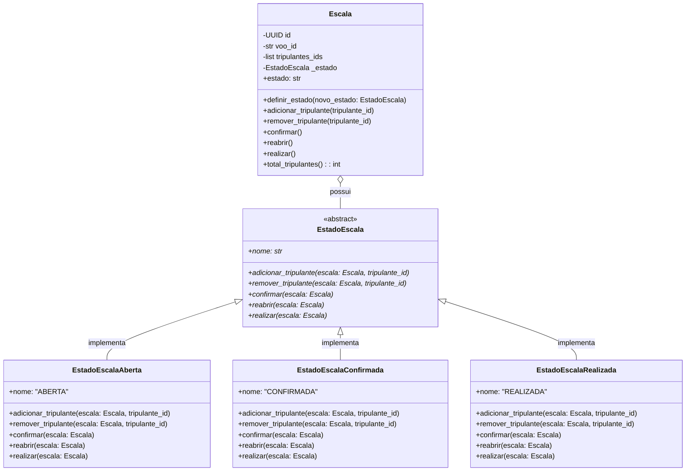
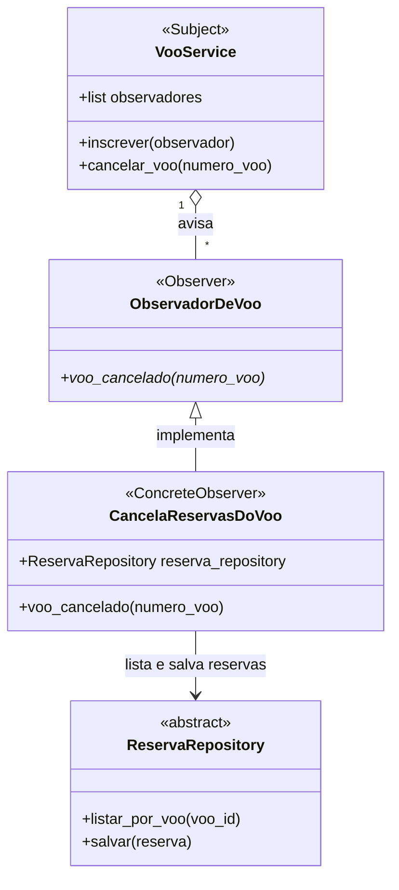
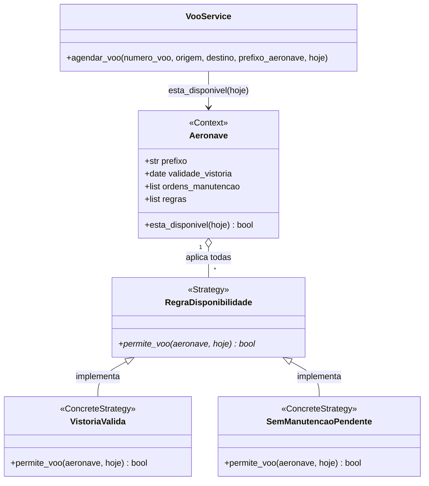
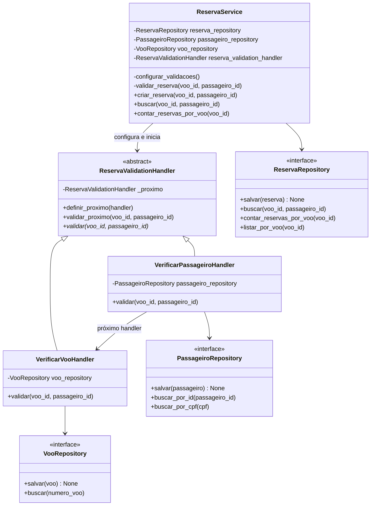
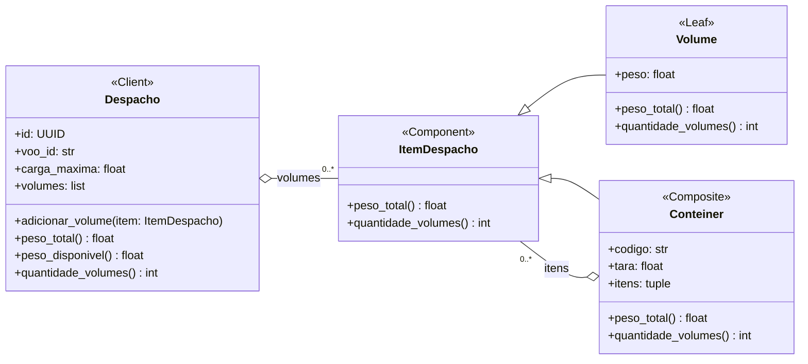

# Padrões de Projeto GoF

## Tripulante e Escala, Filipe Moreira

### Padrão: State (Comportamental)

### 1. Contexto no sistema e problema que ele resolve

No domínio de aviação comercial, uma escala de tripulação não é uma lista estática. Ela possui um ciclo de vida rigoroso regulado por normas operacionais:
1. **Planejamento/Aberta:** O despachante ou escalador aloca pilotos, copilotos e comissários. A tripulação pode ser ajustada, adicionada ou removida livremente.
2. **Confirmada/Homologada:** Antes da decolagem, a tripulação precisa ser confirmada e validada. Nesse estado, não é permitido adicionar ou remover tripulantes sem reabrir formalmente a escala.
3. **Realizada:** Após o voo concluído, a escala torna-se um registro histórico imutável para efeitos de auditoria da ANAC e contabilidade de horas voadas, não admitindo qualquer alteração ou reversão.

Na versão da Fase 1, a classe `Escala` permitia que tripulantes fossem adicionados ou removidos livremente a qualquer momento através de `adicionar_tripulante` e `remover_tripulante`. Não havia controle sobre o momento em que a escala estava pronta, nem proteção contra modificações indevidas em voos já realizados.

### 2. Por que esse padrão e alternativas consideradas

- **Por que State:** O padrão State permite que o objeto `Escala` altere seu comportamento quando seu estado interno muda, parecendo ter mudado de classe. O controle de transições e as regras de permissão/bloqueio ficam encapsulados em classes de estado dedicadas (`EstadoEscalaAberta`, `EstadoEscalaConfirmada`, `EstadoEscalaRealizada`), eliminando comandos condicionais complexos e permitindo novos estados (como `CANCELADA` ou `EM_SOBREAVISO`) sem violar o princípio Aberto/Fechado.
- **Alternativa considerada:** Usar um atributo enumerado `StatusEscala` e encher os métodos da `Escala` com verificações `if/elif` (ex.: `if self.status != StatusEscala.ABERTA: raise ...`). Essa abordagem foi descartada porque espalharia regras condicionais por múltiplos métodos, aumentaria a complexidade ciclomática da raiz e tornaria a adição de novos estados e transições propensa a erros e difícil de manter.

### 3. Participantes do padrão mapeados para classes reais

- **Context (`Contexto`):** `Escala` (`src/airline/domain/model.py`). Mantém uma referência para a instância do estado atual (`_estado`) e expõe métodos de negócio (`adicionar_tripulante`, `remover_tripulante`, `confirmar`, `reabrir`, `realizar`) delegando para o estado corrente.
- **State (`Estado Abstrato`):** `EstadoEscala` (`src/airline/domain/model.py`). Interface abstrata baseada em `ABC` que define as operações que variam conforme o estado da escala.
- **ConcreteStates (`Estados Concretos`):**
  - `EstadoEscalaAberta`: Permite alocar e remover tripulantes. Transita para `EstadoEscalaConfirmada` através de `confirmar()` (exige ao menos 1 tripulante).
  - `EstadoEscalaConfirmada`: Bloqueia inclusão e remoção de tripulantes (`ErroRegraTripulacao`). Permite `reabrir()` voltando para Aberta, ou `realizar()` transitando para Realizada.
  - `EstadoEscalaRealizada`: Bloqueia qualquer mutação na lista de tripulantes e rejeita qualquer nova transição de estado, garantindo a imutabilidade do registro operacional.

### 4. Diagrama de classes

### 5. Testes

Os testes que exercitam o padrão State e suas transições estão em:
- `tests/unit/domain/test_escala.py`:
  - `test_escala_inicia_no_estado_aberta`
  - `test_nao_deve_confirmar_escala_sem_tripulantes`
  - `test_escala_confirmada_bloqueia_adicao_e_remocao_de_tripulantes`
  - `test_escala_confirmada_pode_ser_reaberta_para_edicao`
  - `test_escala_realizada_bloqueia_qualquer_alteracao_e_imutabilidade`
  - `test_escala_aberta_nao_pode_ser_realizada_diretamente`
- `tests/unit/service_layer/test_tripulacao_service.py`:
  - `test_servico_nao_deve_escalar_tripulante_em_escala_confirmada`

Todos os testes foram integrados à suíte completa e executam com sucesso (163/163 testes verdes).

### 6. Custo da aplicação do padrão

A aplicação do padrão State introduz quatro classes adicionais (`EstadoEscala`, `EstadoEscalaAberta`, `EstadoEscalaConfirmada`, `EstadoEscalaRealizada`) e um nível de indireção, já que a entidade delega as ações para a instância polimórfica de estado. Além disso, a reconstrução a partir do banco de dados (`restaurar`) precisa mapear o estado persistido para a classe concreta correspondente através de um dicionário (`MAPA_ESTADOS_ESCALA`).

Esse custo é amplamente compensado pela clareza arquitetural: a entidade `Escala` fica limpa de condicionais de status, as regras de cada estado ficam isoladas e novos estados operacionais podem ser incorporados de forma modular e independente.

## Voo, Matheus Verdan

### Padrão: Observer (Comportamental)

### 1. Contexto no sistema e problema que ele resolve

Desde a fase 1, cancelar um voo só mudava o status dele, e as reservas daquele voo continuavam confirmadas. Registrei essa limitação no DECISIONS em 29/09 e não resolvi na época porque avisar a Reserva de dentro do Voo misturaria os dois agregados. Para a companhia, isso significa passageiros com reserva confirmada num voo que não vai acontecer. A Reserva também não é a única parte do sistema ligada ao voo, porque a Escala e o Despacho guardam o `voo_id` e podem precisar reagir ao cancelamento no futuro.

### 2. Por que esse padrão e alternativas consideradas

O Observer permite que um objeto avise outros quando algo acontece com ele, sem saber quem são nem quantos são. No projeto, o `VooService` cancela o voo, confirma a mudança no banco e depois avisa os observadores inscritos, e cada um decide o que fazer com o aviso. Assim, o serviço do voo não conhece a Reserva, e uma reação nova, como liberar a escala, entra como uma classe nova, sem mudar o `cancelar_voo`.

A primeira alternativa que considerei foi chamar o repositório da Reserva direto no `cancelar_voo`. Isso daria menos código, mas faria o `VooService` depender da Reserva e obrigaria a editar esse método a cada reação nova, justamente o problema de Aberto/Fechado que corrigi no checkpoint 2. Também pensei em guardar a lista de observadores na entidade `Voo`, como costuma aparecer nos exemplos do padrão, mas preferi deixar no serviço, porque assim o domínio continua sem depender de outros agregados e o aviso só sai depois que o serviço grava o cancelamento no banco.

### 3. Participantes do padrão mapeados para classes reais

| Papel no padrão | Classe | O que faz no projeto | Arquivo |
|---|---|---|---|
| Subject e ConcreteSubject | `VooService` | Guarda a lista de observadores, oferece o `inscrever` e avisa todos no fim do `cancelar_voo` | `src/airline/service_layer/services.py` |
| Observer | `ObservadorDeVoo` | Classe abstrata que define o método `voo_cancelado` | `src/airline/service_layer/observadores_voo.py` |
| ConcreteObserver | `CancelaReservasDoVoo` | Cancela as reservas confirmadas do voo que foi cancelado | `src/airline/service_layer/observadores_voo.py` |

Não criei uma classe abstrata para o sujeito porque só o `VooService` avisa observadores, e por isso ele acumula os papéis de Subject e de ConcreteSubject. A função `montar_voo_service`, no `flask_app.py`, já montava o serviço com os repositórios reais e agora também inscreve nele o `CancelaReservasDoVoo`.

Para o observador funcionar, o repositório da Reserva ganhou o método `listar_por_voo`, e o `salvar` passou a atualizar uma reserva que já existe em vez de tentar inseri-la de novo, o que antes falhava com `IntegrityError`. Pedi essas duas mudanças ao Hugo, responsável pela Reserva, e ele as fez nos commits `f8a31c6` e `bbbdf5e`.

### 4. Diagrama de classes

### 5. Testes

Os testes de unidade do padrão ficam em `tests/unit/service_layer/test_observadores_voo.py` e entraram nos commits `4854e41` e `7bdf72d`.

- `test_cancelar_voo_avisa_todos_os_observadores` inscreve dois observadores de teste, que só anotam os voos recebidos, e confere que os dois receberam o número do voo.
- `test_cancelamento_recusado_nao_avisa_ninguem` tenta cancelar um voo já realizado e confere que nenhum observador foi avisado.
- `test_cancela_so_as_reservas_confirmadas_do_voo` usa o repositório falso da Reserva e confere que só as reservas do voo cancelado mudaram de status.

O teste ponta a ponta `test_cancelar_voo_cancela_as_reservas_pela_api`, em `tests/e2e/test_api_voo.py` (commit `3abb7b1`), agenda um voo, cria um passageiro com uma reserva, cancela o voo pela API e confere que a reserva ficou CANCELADA. Em 10/11, a suíte inteira passou com 189 testes.

### 6. Custo da aplicação do padrão

O padrão trouxe uma classe abstrata, uma classe concreta e uma lista no `VooService`. Quem lê o `cancelar_voo` não vê mais o que acontece depois do cancelamento e precisa olhar o `montar_voo_service` para saber quem reage a ele. Além disso, o aviso sai depois do commit do voo e cada reserva é gravada pelo próprio repositório, então, se o observador falhar no meio, o voo fica cancelado e parte das reservas continua confirmada, sem nova tentativa. Compensa porque o Voo e a Reserva continuam separados e as próximas reações ao cancelamento entram como classes novas, sem alterar o que já está testado.

## Aeronave, Matheus Andrade

### Padrão: Strategy (Comportamental)

### 1. Contexto no sistema e problema que ele resolve

A regra principal do agregado Aeronave é que uma aeronave com vistoria vencida ou com manutenção pendente não pode voar. O `VooService.agendar_voo` pergunta isso pelo `esta_disponivel(hoje)`. Até o checkpoint 2, as duas condições ficavam numa expressão só dentro desse método. Funcionava, mas a companhia tem outros motivos para deixar uma aeronave no chão, como um limite de horas de voo ou dias de manutenção programada, e cada motivo novo obrigaria a editar a `Aeronave`.

### 2. Por que esse padrão e alternativas consideradas

O Strategy separa algoritmos com a mesma interface e deixa o objeto que os usa trocar de algoritmo sem mudar o próprio código. Aqui, cada regra virou uma estratégia que recebe a aeronave e a data e responde se permite o voo. A `Aeronave` guarda uma lista de regras e só está disponível quando todas permitem. É uma variação do padrão, porque o contexto aplica várias estratégias ao mesmo tempo, e não uma por vez.

A primeira alternativa era manter a expressão com `and`, que é menos código, mas continuaria exigindo editar a `Aeronave` a cada regra nova, o problema de Aberto/Fechado que o padrão resolve. Também pensei em montar a lista no `VooService`, mas isso obrigaria a mudar o serviço, o `to_domain` do ORM e os testes antigos. Preferi um parâmetro opcional com as duas regras atuais como padrão, para que o código existente continuasse funcionando igual.

### 3. Participantes do padrão mapeados para classes reais

| Papel no padrão | Classe | O que faz no projeto | Arquivo |
|---|---|---|---|
| Strategy | `RegraDisponibilidade` | Classe abstrata que define o método `permite_voo(aeronave, hoje)` | `src/airline/domain/model.py` |
| ConcreteStrategy | `VistoriaValida` | Permite o voo enquanto a validade da vistoria não passou de `hoje` | `src/airline/domain/model.py` |
| ConcreteStrategy | `SemManutencaoPendente` | Permite o voo quando nenhuma ordem de manutenção está pendente | `src/airline/domain/model.py` |
| Context | `Aeronave` | Guarda a lista `regras` e, no `esta_disponivel`, exige que todas permitam o voo | `src/airline/domain/model.py` |

As classes ficaram no `model.py` porque as regras são parte do domínio. O `VooService` continua chamando só `esta_disponivel`, sem conhecer as regras.

### 4. Diagrama de classes

### 5. Testes

Antes de refatorar, escrevi `tests/unit/domain/test_disponibilidade_aeronave.py` (commit `9a9f6c5`), uma tabela com 8 combinações de vistoria e ordens de manutenção que passou antes e depois da refatoração, sem alteração.

Os testes do padrão ficam em `tests/unit/domain/test_regras_disponibilidade.py`:

- Commit `3ad275b`: testa cada estratégia sozinha e confere que a aeronave usa as duas por padrão. Entrou antes da implementação e só passou com o commit `4606a68`, que aplicou o padrão.
- Commit `a5669dd`: `test_regra_nova_entra_na_aeronave_sem_editar_a_classe` cria a regra `ForaDosDiasBloqueados` dentro do próprio teste e a passa para a aeronave, que fica indisponível no dia bloqueado sem nenhuma mudança na classe `Aeronave`.

Em 10/11, a suíte inteira passou com 199 testes.

### 6. Custo da aplicação do padrão

O padrão trouxe três classes para uma lógica que antes cabia em três linhas, e quem lê o `esta_disponivel` precisa olhar o construtor para saber quais regras valem. As regras também não são gravadas no banco: o `to_domain` sempre volta com as regras padrão, o que não muda nada enquanto todas as aeronaves usam as mesmas. Compensa porque o próximo motivo para deixar uma aeronave no chão entra como uma classe nova, sem mexer no que já está testado.

## Reserva e Passageiro, Hugo Vargas

### Chain of Responsibility — Reserva

### 1. Nome e categoria

**Padrão:** Chain of Responsibility (Cadeia de Responsabilidade).

**Categoria:** Comportamental.

### 2. Contexto e problema

No módulo de Reserva, as operações de criação e busca precisam verificar se o passageiro e o voo informados existem antes de continuar a execução.

Originalmente, essas verificações eram realizadas diretamente nos métodos `criar_reserva()` e `buscar()` do `ReservaService`.

O padrão foi aplicado para separar as validações em handlers independentes, organizados em uma cadeia, evitando concentrar essas responsabilidades no serviço.

### 3. Justificativa da escolha

O Chain of Responsibility permite organizar verificações sequenciais em handlers independentes, nos quais cada componente executa sua validação e encaminha a solicitação ao próximo handler caso ela seja aprovada.

Uma alternativa considerada seria manter as verificações diretamente no `ReservaService`, utilizando estruturas condicionais (`if`). Essa alternativa possui menor complexidade e seria suficiente para o cenário atual.

O CoR foi escolhido para separar as responsabilidades de validação e permitir a inclusão de novas verificações independentes sem concentrar suas implementações nos métodos do serviço.

### 4. Participantes do padrão

| Participante | Classe no projeto | Responsabilidade |
|---|---|---|
| Handler | `ReservaValidationHandler` | Define o contrato de validação e o encaminhamento para o próximo handler. |
| Concrete Handler | `VerificarPassageiroHandler` | Verifica se o passageiro existe. |
| Concrete Handler | `VerificarVooHandler` | Verifica se o voo existe. |
| Client | `ReservaService` | Configura a cadeia e inicia sua execução nas operações de criação e busca. |

### 5. Diagrama de classes

### 6. Testes

Foram implementados testes unitários para verificar:

- A execução dos dois handlers quando passageiro e voo existem.
- A interrupção da cadeia e o lançamento de `PassageiroNaoEncontrado` quando o passageiro não existe.
- A interrupção da cadeia e o lançamento de `VooNaoEncontrado` quando o voo não existe.

Os testes anteriores do `ReservaService` também foram executados e continuaram passando após a implementação.

### 7. Custo da aplicação

A aplicação do padrão aumentou a complexidade estrutural do módulo de Reserva. Foram necessárias uma classe abstrata, duas classes concretas de handlers e a configuração do encadeamento.

Essa estrutura exige maior esforço de manutenção e testes em comparação com a implementação original, que utilizava apenas estruturas condicionais no serviço.

Como o fluxo atual possui somente duas validações, o CoR introduz uma complexidade adicional que não seria necessária em uma solução mais simples. Em contrapartida, separa as responsabilidades de validação e facilita a inclusão de novos handlers independentes.

## Despacho, Vinicius Duarte

### Padrão: Composite (estrutural)

### Contexto e problema

O Despacho controla o peso embarcado num voo e não deixa passar da `carga_maxima` (ADR 0005). Na Fase 1 ele só conhecia uma lista plana de `Volume`, cada um com seu peso.

Na prática, bagagem e carga quase nunca vão soltas no porão. Elas são agrupadas em contêineres (os ULD, como o AKE, um contêiner de bagagem, ou o PMC, um palete). O contêiner tem um código, tem peso próprio (a tara, perto de 80 kg num AKE) e pode levar volumes ou até outros contêineres, quando vários AKE vão presos num palete.

Com o modelo antigo, havia dois problemas:

- **A tara não era contada.** Para registrar um contêiner, o funcionário teria de lançar os volumes um a um, e o peso do próprio contêiner ficava de fora da conta da carga máxima. Um despacho podia parecer dentro do limite e não estar. O teste `test_tara_do_conteiner_conta_na_carga_maxima` mostra o caso: volumes de 150 kg num despacho de 200 kg passam, mas com a tara de 80 kg não.
- **O Despacho teria de saber de cada tipo de item.** Sem um tipo comum, `adicionar_volume` e `peso_total` precisariam de um `if` para volume, outro para contêiner, e um laço para contêiner dentro de contêiner.

### Por que Composite

O Composite deixa o Despacho tratar uma peça e um grupo de peças pela mesma interface. Tanto o `Volume` quanto o `Conteiner` sabem responder `peso_total()` e `quantidade_volumes()`. O contêiner calcula o seu somando a tara com o que ele tem dentro, e não precisa saber se o que tem dentro é volume ou outro contêiner. Com isso, a regra da carga máxima em `Despacho.adicionar_volume` não mudou: ela continua comparando `peso_total()` com a `carga_maxima`, só que agora o peso de um contêiner inteiro entra de uma vez.

**Alternativas consideradas:**

- **Guardar a tara como um volume a mais.** Seria a mudança mínima: lançar um `Volume(peso=80)` para cada contêiner. Descartei porque a tara deixaria de ser identificável (não daria para saber de qual contêiner é), a `quantidade_volumes` contaria contêiner como volume e não haveria como representar um contêiner dentro de um palete.
- **Um campo `conteiner` em cada `Volume`.** Cada volume diria em qual contêiner está, e o Despacho agruparia na hora de somar. Descartei porque o Despacho teria de montar os grupos a cada cálculo, a tara precisaria morar em outro lugar e o aninhamento (contêiner em palete) ficaria sem representação.
- **Decorator.** Também é estrutural e também tem a mesma interface do objeto embrulhado, mas ele acrescenta comportamento a *um* objeto. Aqui o problema é juntar *vários* itens num só, que é o caso do Composite.

### Participantes

| Papel no padrão | Classe no código | Onde está |
|---|---|---|
| Component | `ItemDespacho` (ABC, com `peso_total()` e `quantidade_volumes()`) | `src/airline/domain/model.py` |
| Leaf | `Volume` (objeto de valor, `frozen=True`): o peso total é o próprio peso e conta 1 volume | `src/airline/domain/model.py` |
| Composite | `Conteiner` (objeto de valor, `frozen=True`, com `codigo`, `tara` e `itens`): soma a tara com o peso de cada item e repassa a contagem para os filhos | `src/airline/domain/model.py` |
| Client | `Despacho`: guarda uma lista de `ItemDespacho` e usa só a interface comum em `adicionar_volume`, `peso_total` e `quantidade_volumes` | `src/airline/domain/model.py` |

Fora do domínio, o padrão aparece em mais dois lugares:

- `DespachoService.adicionar_conteiner` monta o `Conteiner` e entrega ao Despacho pelo mesmo `adicionar_volume` do volume solto.
- No banco, a árvore fica na tabela `despacho_volumes`, com as colunas `tipo` (`VOLUME` ou `CONTEINER`), `codigo` e `pai_id`, que aponta para o contêiner onde o item está. A conversão é feita por `itens_para_models` e `models_para_itens`, em `src/airline/adapters/orm.py`. Na linha de um contêiner, a coluna `peso` guarda a tara.

O `Conteiner` é imutável: os itens viram uma tupla na criação. Decidi assim porque, se fosse possível colocar um volume num contêiner que já está no despacho, o peso aumentaria sem passar por `Despacho.adicionar_volume`, e a invariante da carga máxima seria furada por fora da raiz.

### Diagrama de classes

### Testes

- `tests/unit/domain/test_despacho.py` exercita o padrão direto no domínio:
  - `test_peso_do_conteiner_soma_a_tara_e_os_volumes`
  - `test_conteiner_vazio_pesa_so_a_tara`
  - `test_conteiner_dentro_de_conteiner_soma_recursivamente`: palete com dois AKE e um volume solto
  - `test_despacho_trata_volume_e_conteiner_do_mesmo_jeito`
  - `test_tara_do_conteiner_conta_na_carga_maxima`
  - `test_conteiner_nao_aceita_volume_depois_de_criado`
- `tests/unit/service_layer/test_despacho_service.py`: `test_adicionar_conteiner_com_volumes`, `test_adicionar_conteiner_acima_da_carga_maxima` e `test_adicionar_conteiner_em_despacho_inexistente`, com o repositório falso.
- `tests/integration/adapter/test_SqlAlchemyDespachoRepository.py`:
  - `test_salvar_despacho_com_conteiner_grava_a_arvore`
  - `test_buscar_despacho_reconstroi_conteiner_aninhado`
  - `test_salvar_de_novo_despacho_com_conteiner_nao_duplica_linhas`

  Os três conferem o banco com SQL puro, como os outros testes de integração do Despacho.
- `tests/e2e/test_api.py`: `test_api_deve_adicionar_conteiner_no_despacho` (`POST /despachos/<id>/conteineres`) e `test_api_erro_quando_tara_do_conteiner_passa_da_carga_maxima`.

Os testes antigos do Despacho não mudaram e continuam passando, o que mostra que o volume solto se comporta como antes.

### Custo

- **Mais tipos no domínio.** O agregado tinha duas classes (`Despacho` e `Volume`) e passou a ter quatro (`ItemDespacho` e `Conteiner` a mais). Quem lê `adicionar_volume` precisa saber que "volume" agora quer dizer "qualquer item do despacho".
- **A persistência ficou mais complexa.** Uma tabela plana virou uma árvore numa tabela só, com auto-referência (`pai_id`), e a conversão passou a ser recursiva nos dois sentidos. Foi a parte mais trabalhosa, e o adaptador precisa conhecer as classes concretas (`isinstance(item, Conteiner)`) para gravar o tipo certo.
- **A interface comum é mínima.** Só peso e quantidade são comuns. Operações que só fazem sentido no contêiner, como o código, ficam fora do `ItemDespacho`, e quem precisar delas tem de perguntar o tipo.
- **Nenhum limite próprio do contêiner.** Um AKE real tem peso máximo próprio, e o código ainda não verifica isso.

Mesmo assim o custo compensa: a regra da carga máxima continuou num lugar só e sem nenhum `if` por tipo de item, e a tara, que antes ficava de fora, agora entra na conta.
