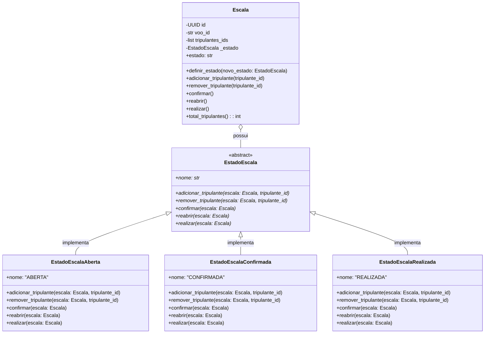

# Padrões de Projeto GoF

## Tripulante e Escala, Filipe Moreira

### Padrão: State (Comportamental)

### 1. Contexto no sistema e problema que ele resolve

No domínio de aviação comercial, uma escala de tripulação não é uma lista estática. Ela possui um ciclo de vida rigoroso regulado por normas operacionais:
1. **Planejamento/Aberta:** O despachante ou escalador aloca pilotos, copilotos e comissários. A tripulação pode ser ajustada, adicionada ou removida livremente.
2. **Confirmada/Homologada:** Antes da decolagem, a tripulação precisa ser confirmada e validada. Nesse estado, não é permitido adicionar ou remover tripulantes sem reabrir formalmente a escala.
3. **Realizada:** Após o voo concluído, a escala torna-se um registro histórico imutável para efeitos de auditoria da ANAC e contabilidade de horas voadas, não admitindo qualquer alteração ou reversão.

Na versão da Fase 1, a classe `Escala` permitia que tripulantes fossem adicionados ou removidos livremente a qualquer momento através de `adicionar_tripulante` e `remover_tripulante`. Não havia controle sobre o momento em que a escala estava pronta, nem proteção contra modificações indevidas em voos já realizados.

### 2. Por que esse padrão e alternativas consideradas

- **Por que State:** O padrão State permite que o objeto `Escala` altere seu comportamento quando seu estado interno muda, parecendo ter mudado de classe. O controle de transições e as regras de permissão/bloqueio ficam encapsulados em classes de estado dedicadas (`EstadoEscalaAberta`, `EstadoEscalaConfirmada`, `EstadoEscalaRealizada`), eliminando comandos condicionais complexos e permitindo novos estados (como `CANCELADA` ou `EM_SOBREAVISO`) sem violar o princípio Aberto/Fechado.
- **Alternativa considerada:** Usar um atributo enumerado `StatusEscala` e encher os métodos da `Escala` com verificações `if/elif` (ex.: `if self.status != StatusEscala.ABERTA: raise ...`). Essa abordagem foi descartada porque espalharia regras condicionais por múltiplos métodos, aumentaria a complexidade ciclomática da raiz e tornaria a adição de novos estados e transições propensa a erros e difícil de manter.

### 3. Participantes do padrão mapeados para classes reais

- **Context (`Contexto`):** `Escala` (`src/airline/domain/model.py`). Mantém uma referência para a instância do estado atual (`_estado`) e expõe métodos de negócio (`adicionar_tripulante`, `remover_tripulante`, `confirmar`, `reabrir`, `realizar`) delegando para o estado corrente.
- **State (`Estado Abstrato`):** `EstadoEscala` (`src/airline/domain/model.py`). Interface abstrata baseada em `ABC` que define as operações que variam conforme o estado da escala.
- **ConcreteStates (`Estados Concretos`):**
  - `EstadoEscalaAberta`: Permite alocar e remover tripulantes. Transita para `EstadoEscalaConfirmada` através de `confirmar()` (exige ao menos 1 tripulante).
  - `EstadoEscalaConfirmada`: Bloqueia inclusão e remoção de tripulantes (`ErroRegraTripulacao`). Permite `reabrir()` voltando para Aberta, ou `realizar()` transitando para Realizada.
  - `EstadoEscalaRealizada`: Bloqueia qualquer mutação na lista de tripulantes e rejeita qualquer nova transição de estado, garantindo a imutabilidade do registro operacional.

### 4. Diagrama de classes

### 5. Testes

Os testes que exercitam o padrão State e suas transições estão em:
- `tests/unit/domain/test_escala.py`:
  - `test_escala_inicia_no_estado_aberta`
  - `test_nao_deve_confirmar_escala_sem_tripulantes`
  - `test_escala_confirmada_bloqueia_adicao_e_remocao_de_tripulantes`
  - `test_escala_confirmada_pode_ser_reaberta_para_edicao`
  - `test_escala_realizada_bloqueia_qualquer_alteracao_e_imutabilidade`
  - `test_escala_aberta_nao_pode_ser_realizada_diretamente`
- `tests/unit/service_layer/test_tripulacao_service.py`:
  - `test_servico_nao_deve_escalar_tripulante_em_escala_confirmada`

Todos os testes foram integrados à suíte completa e executam com sucesso (163/163 testes verdes).

### 6. Custo da aplicação do padrão

A aplicação do padrão State introduz quatro classes adicionais (`EstadoEscala`, `EstadoEscalaAberta`, `EstadoEscalaConfirmada`, `EstadoEscalaRealizada`) e um nível de indireção, já que a entidade delega as ações para a instância polimórfica de estado. Além disso, a reconstrução a partir do banco de dados (`restaurar`) precisa mapear o estado persistido para a classe concreta correspondente através de um dicionário (`MAPA_ESTADOS_ESCALA`).

Esse custo é amplamente compensado pela clareza arquitetural: a entidade `Escala` fica limpa de condicionais de status, as regras de cada estado ficam isoladas e novos estados operacionais podem ser incorporados de forma modular e independente.

## Voo, Matheus Verdan

## Aeronave, Matheus Andrade

## Reserva e Passageiro, Hugo Vargas

## Despacho, Vinicius Duarte
